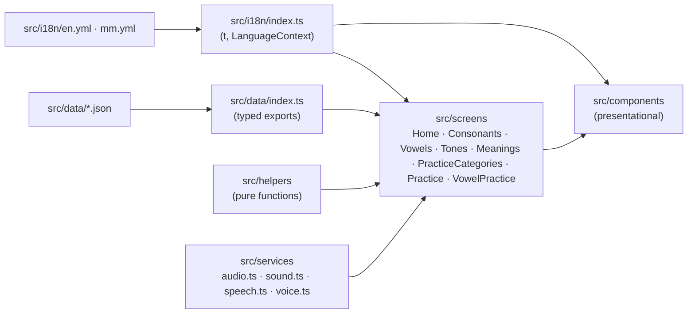
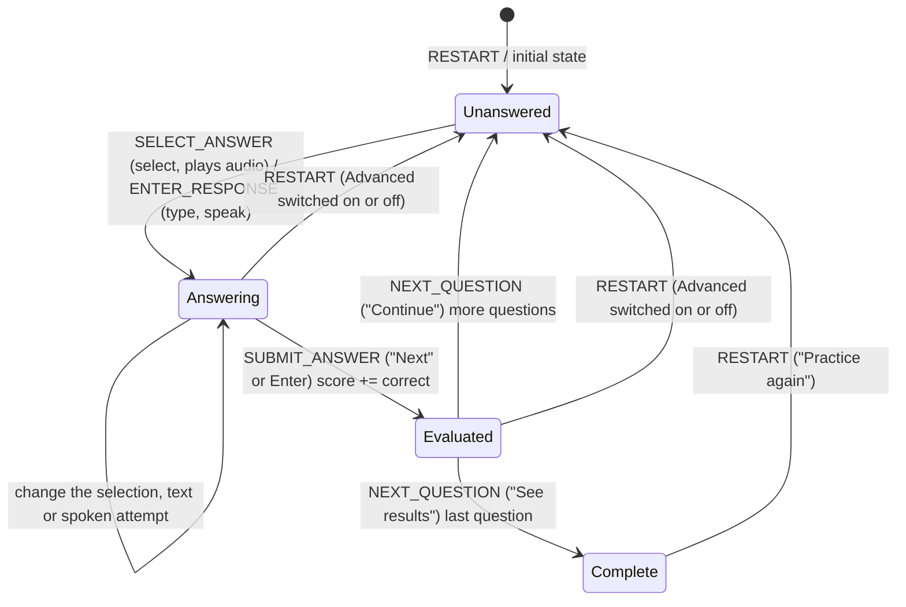

# Architecture

## Principles

1. Client-side only until persistence is actually required.
2. Learning content is data (`src/data/*.json`) and UI text is translations (`src/i18n/*.yml`), never component code.
3. Burmese pronunciation is reviewed content: the book's is kept as given, and any written for words the book lacks
   follows the book's own spelling and is listed for the owner's review.
4. Thai audio is a separate asset from Burmese pronunciation.
5. Components present; screens compose; helpers compute; services perform side effects.
6. No abstraction before a real requirement.

## Layers



| Layer         | Responsibility                                       | May import                                      |
| ------------- | ---------------------------------------------------- | ----------------------------------------------- |
| `data/`       | Static content and its typed loader                  | `types/`                                        |
| `helpers/`    | Pure, deterministic-when-seeded logic                | `types/`, `constants/`, other helpers           |
| `services/`   | Browser side effects (audio, pictures, theme)        | nothing app-specific                            |
| `i18n/`       | UI text in English and Burmese, the language context | the `.yml` files                                |
| `components/` | Rendering and user interaction via props             | `helpers/`, `types/`, `i18n/`, other components |
| `screens/`    | Routing targets: state, data, services, composition  | everything                                      |

## Routing

`BrowserRouter` with `basename = import.meta.env.BASE_URL`, so the app works at a domain root or a sub-path. English
pages have no prefix (`/consonants/all`), since English is the default; Burmese pages live under `/my`
(`/my/consonants/all`). `main.tsx` reads the language from
the path once and adds `my` to the basename for Burmese, so every route below works in both languages and links stay in the
language they start in. The paths below are relative to that basename.

| Path                                           | Screen                                                                                                                                                                                                                                                                                                                                                                                        |
| ---------------------------------------------- | --------------------------------------------------------------------------------------------------------------------------------------------------------------------------------------------------------------------------------------------------------------------------------------------------------------------------------------------------------------------------------------------- |
| `/`                                            | Home                                                                                                                                                                                                                                                                                                                                                                                          |
| `/consonants?class=middle\|high\|low`          | Consonant browser (class kept in the URL so it can be linked)                                                                                                                                                                                                                                                                                                                                 |
| `/vowels?group=short\|long\|extra\|standalone` | The 32 vowels in group tabs (group kept in the URL), with the short and long vowel tone rules and a middle / high / low class example per vowel                                                                                                                                                                                                                                               |
| `/tones`                                       | The five tones, then two tables with a Group 1 / 2 / 3 column per consonant class: short and long vowels (the tone each group takes, e.g. short + group 3 = high) and the four tone marks                                                                                                                                                                                                     |
| `/meanings`                                    | The 60 words of the source's chapter 3 (Pictures tab): picture, Thai word, meaning and a button that plays the word, in the source's order                                                                                                                                                                                                                                                    |
| `/meanings/text`                               | The Text tab: the same words as compact cards with the Thai word, its meaning followed by its pronunciation in brackets (`mountain (phuu-khao)`, `တောင်တန်း (ဖူးခေါင်)`), and each syllable's tone as a small pitch curve in the top right corner (its name for screen readers only); a three-dot Card options menu hides the Thai, tone, meaning or pronunciation, at least one stays ticked |
| `/practice`                                    | Practice categories: Consonants or Vowels                                                                                                                                                                                                                                                                                                                                                     |
| `/practice/consonants`                         | Picture quiz                                                                                                                                                                                                                                                                                                                                                                                  |
| `/practice/vowels`                             | Consonant + vowel quiz over the ticked vowel groups (short / long / extra), asking the sound of a vowel or the tone of a syllable                                                                                                                                                                                                                                                             |
| `/consonants/all`                              | The All tab on the consonant page: all 44 consonants as compact cards in Middle / High / Low class columns side by side (letter, meaning above the pronunciation; no picture, Thai word or audio); a three-dot Card options menu (top right of the columns) hides the Thai, meaning or pronunciation, at least one stays ticked                                                               |
| `/vowels/all`                                  | The All tab on the vowel page: the 28 short, long and extra vowels as large cards in three side-by-side group columns (vowel, English sound, Burmese pronunciation; no class examples, standalone vowels or audio); a three-dot Card options menu (top right of the columns) hides the Thai, sound or Burmese pronunciation (Burmese only), at least one stays ticked                         |
| `/all`                                         | Redirects to `/consonants/all` (the earlier address of the consonant overview)                                                                                                                                                                                                                                                                                                                |
| `*`                                            | Redirects to `/`                                                                                                                                                                                                                                                                                                                                                                              |

Static hosts must serve `index.html` for unknown paths. Cloudflare Pages does this automatically because the build has no
`404.html`.

## Data model

Types live in `src/types/learning.ts`.

```ts
type ConsonantClassId = 'middle' | 'high' | 'low';

interface ConsonantClass {
  id: ConsonantClassId;
  group: number; // 1 middle, 2 high, 3 low — the numbers asked in group questions
  tone: ToneId; // the class's live-syllable tone; names are in src/i18n (classes.<id>.name, .shortName)
}

interface Word {
  id: string; // "<consonant>-<thai>", e.g. "ก-ไก่"
  thai: string; // "ไก่"
  pronunciation: string; // Burmese pronunciation as given in the source, e.g. "ကောကိုင်"
  meaning: string; // Burmese meaning, e.g. "ကြက်"
  meaningEn: string; // English meaning, e.g. "chicken"
  pronunciationEn: string; // romanized letter name, e.g. "gor gai"
  image?: string; // "/images/words/kai.svg"
  audio?: string; // "/audio/words/kai.m4a"
}

interface Consonant {
  id: string;
  character: string;
  class: ConsonantClassId;
  words: Word[];
}

type AnswerMode = 'select' | 'class' | 'type' | 'speak';

interface PracticeQuestion {
  id: string;
  answer: VocabularyItem;
  options: VocabularyItem[]; // always generated, so any question can fall back to select
  mode: AnswerMode;
}
```

`words` is an array so a consonant can gain more vocabulary later without a schema change. Asset paths are stored
root-relative and resolved at render time with `assetUrl()` so a sub-path deployment still works.

## Practice engine

`src/helpers/practice.ts` is pure and UI-free.

- `generatePracticeQuestions(vocabulary, { questionCount, optionCount, modes, random })`
  - pool = vocabulary items that have an image;
  - shuffles the pool (question order) and takes `questionCount` answers (default `QUESTION_COUNT`, 10), each asked once;
    the learner sets 5–30 (`MIN_QUESTION_COUNT`, `MAX_QUESTION_COUNT`) in the ⋮ practice settings menu with − / +
    (one at a time) or by typing a number, applied on Enter or blur and clamped to the range; this restarts the practice;
  - for each answer picks `ANSWER_OPTION_COUNT - 1` (2) distractors from the same pool with unique Thai text;
  - shuffles the options so the correct position varies;
  - gives each question a random answer mode from `modes` (default `['select']`) via `assignAnswerModes`.
  - `random` is injectable for deterministic tests. `randomizeArray` never mutates its input.
- `getAnswerModes({ advanced, enabled })`: `select` only when Advanced is off; otherwise `select` plus each of
  `class`, `type` and `speak` that is enabled. The Practice screen enables them with the Audio / Type / Group checkboxes
  in the ⋮ practice settings menu right of the Advanced toggle (shown there while Advanced is on), and leaves `speak` out when the
  browser has no speech recognition. "Can't speak now" unticks Audio.
- `practiceReducer(state, action)` drives the session:



Switching Advanced on or off, or ticking a question type, restarts the practice with new questions in the new modes. `SET_ANSWER_MODES`
("Can't speak now") re-assigns the modes of the current question, if it is not yet evaluated, and every later question;
a current question whose mode changes loses its unsubmitted answer.

```ts
interface PracticeState {
  questions: PracticeQuestion[];
  currentQuestionIndex: number;
  selectedAnswerId: string | null; // select questions
  response: string; // typed text or the chosen speech transcript
  answered: boolean;
  score: number;
}
```

Invalid transitions (answering after evaluation, answering in the wrong mode, submitting with nothing selected or blank
text, advancing before evaluation) return the same state object. State lives in `useReducer` inside the Practice screen
and is never persisted; the Advanced toggle is screen state and starts off on every visit.

### Answer modes

| Mode     | Prompt                                                  | Correct when                                                                 |
| -------- | ------------------------------------------------------- | ---------------------------------------------------------------------------- |
| `select` | picture, "Which word is this?"                          | the chosen option is the answer                                              |
| `class`  | picture + `ก (ไก่)` and pronunciation, groups 1 / 2 / 3 | the chosen group is the letter's class (`VocabularyItem.consonantClass`)     |
| `type`   | picture + Burmese pronunciation hint                    | the text is the letter `ก`; `ไก่`, `ก ไก่`, `ก (ไก่)` or `กอ ไก่` also count |
| `speak`  | picture only, "Say this word"                           | a recognized transcript contains the word                                    |

`src/helpers/thaiAnswer.ts` compares after `normalizeThai` (NFKC, spaces, brackets and zero-width characters removed),
so mark order and `ำ`/`ํา` spellings don't matter. For `speak`, the recognizer returns up to 5 alternatives and the
first one containing the word is kept. Checking an answer plays a feedback sound; class, type and speak questions then play
the word's Thai audio once that sound has finished.

## Vowels

Data: `vowelGroups.json` and `vowels.json` (32 vowels: 12 short, 12 long, 4 extra ำ ใ ไ เา, 4 standalone ฤ ฤๅ ฦ ฦๅ). A
vowel id is its written form with `-` for the consonant (`เ-ือะ`); standalone vowels have no dash. Short and long
vowels have one tone rule per consonant class, from the source. Each consonant class names an
`exampleConsonant` (ก / ข / ค) and its English initial `exampleSound` (k / kh / kh); a vowel example's romanization is
`exampleSound` + the vowel's `sound` (กะ → ka).

`src/helpers/vowels.ts`: `combineVowel` replaces the dash with a consonant; `getVowelLabel` shows `◌` instead of the dash
where a mark sits above or below the consonant (`◌ิ`, `เ◌ีย`), because fonts can't stack a Thai mark on a dash.
The screen draws combinable groups with `VowelTable` (one row per vowel: a button that plays the vowel's `audio`, the row
number, the Thai vowel beside its Burmese pronunciation and English sound in brackets, `( အ - a )` — in English just
`( a )` — then a ก / ข / ค
column per class) and
standalone vowels with `VowelCard`.

## Tones

Data: `tones.json` (5 tones with their Thai name and a 1–5 pitch contour), `toneMarks.json` (่ ้ ๊ ๋) and
`guide.json` (the Thai names of live and dead syllables). The tone names and the explanations on the tones screen are UI
text in `src/i18n` (`tones.*`, `syllables.*`, `tonesPage.*`).

The tones screen shows the five tones as compact cards, each with a button that plays its `example` syllable
(`public/audio/tones/<id>.m4a`), then a "Short and long vowels" table built from `vowelGroups.json`'s `tones` (the
same source rule the Vowels page shows: short vowels give low / low / high for groups 1–3, long vowels mid / rising /
mid), with each row's live/dead syllable term underneath, and a "Tone marks" table from `getMarkedTone`. Both use
`ClassTable` with `showGroups`, which labels each class column with its group number.

- `src/helpers/tones.ts`: `getUnmarkedTone(class, 'live' | 'dead')` and `getMarkedTone(class, mark)` hold the tone rules.
  Only open syllables (no final consonant) are modelled.
- `src/helpers/vowels.ts`: short vowels make dead syllables, long and extra vowels live ones (`getSyllable`,
  `getSyllableTone`). `src/data/vowels.test.ts` checks each vowel group's written tone rule against these.

## Meanings

Data: `meanings.json`, the 60 words of the source's chapter 3 in the source's order (`MeaningWord`: `id`, `thai`, `syllables`,
Burmese `meaning`, `meaningEn`, `image`, `audio`). The id is the Thai word; the two pairs spelt alike (กา kettle / crow, ตา eye /
grandfather) add the English meaning (`กา-kettle`). The screen draws each word with `WordCard`: the default size has the
picture, Thai word, meaning and audio button; the Text tab uses the compact size without picture or audio, with the Thai shrinking
to fit long words (a word can't wrap). The Text tab shows each syllable's tone in the card's top right corner: the words are open syllables
with no tone marks, so `findSyllable` (`src/helpers/vowels.ts`) finds each syllable's consonant and vowel and
`getSyllableTone` gives its tone, drawn with a small `ToneContour`. Thai keeps empty space above letters for marks, so the word is lifted by what its
tallest character leaves empty (`getThaiInkHeight` in `src/helpers/thaiInk.ts`, measured for Sarabun): its top sits 4px
below the curves, the same as the curves below the card's edge. `syllables` is stored because some words split more
than one way (`เลอะเทอะ` is `เลอะ|เทอะ`, not `เล|อะ|เทอะ`). The words are not part of any practice yet.

## Vowel practice

`generateVowelQuestions(consonants, vowels, { questionCount, optionCount, random })` in `src/helpers/vowels.ts` shuffles
every consonant × combinable vowel pair, takes `questionCount` distinct ones and makes each either a `sound` question or a
`tone` question (the five tones). A `sound` question shows only the vowel (`โ-`) and offers 3 vowels' sounds as
`( အိုး - oo )` (`VowelSound`, the same format as the vowel table); options never share a sound (`ใ-` and `ไ-` are both
"ai"), and each vowel is asked this way at most once per round. After answering, the vowel's recorded audio plays. The learner ticks which
vowel groups to practise (short / long / extra, at least one); changing them restarts with new questions. The screen
keeps its session in `useState`.

## Audio

`src/services/audio.ts` keeps a single `HTMLAudioElement`. `playAudio(src)` stops the current sound before starting the
next one, so rapid answer changes never overlap. Rejected playback (autoplay policy, missing file) is swallowed so
learning continues silently. Screens call `stopAudio()` on unmount and when moving to the next question.

## Picture preloading

`src/services/images.ts`: `preloadImages(sources)` fetches the 44 vocabulary pictures (about 45 KB compressed) in the
background. `main.tsx` calls it once; it waits for the page's `load` event and an idle moment, so the first screen's own
requests go first. Afterwards consonant tabs and the picture quiz show pictures without waiting for the
network, which matters on slow connections. The pictures are small, so cards load them eagerly (no `loading="lazy"`).

## Feedback sounds

`src/services/sound.ts` synthesizes the check sounds with the Web Audio API, so there are no sound files: a rising
two-note chime for a correct answer and a low falling tone for an incorrect one (`FEEDBACK_SOUND_DURATION_MS` long).
One `AudioContext` is created lazily on the first check (a user gesture, as iOS requires) and resumed if the browser
suspended it. Missing Web Audio or any playback error is swallowed.

## Thai speech synthesis

`src/services/voice.ts` speaks Thai with the browser's `speechSynthesis` (`th-TH`, a Thai voice when installed), for vowel
practice syllables that have no recorded audio. A tone question's syllable is spoken
only after it is answered (hearing it first would give the tone away), and a speaker button replays it. A missing API,
missing Thai voice or any error is silent. Pronunciation quality depends on the device's voice.

## Speech recognition

`src/services/speech.ts` wraps the Web Speech API (`SpeechRecognition`, or `webkitSpeechRecognition` in Safari).
`listen('th-TH')` runs one short recognition and always resolves, never rejects: `heard` with the transcripts,
`no-speech`, `blocked` (microphone permission or capture), `failed` (network, unsupported language…) or `aborted`.
Like audio, a single recognizer is active at a time; `stopListening()` aborts it. The Practice screen ignores results
that arrive after the question changed. Recognition runs on the browser vendor's service, so it needs a connection;
Firefox has no support, and there `speak` is never offered.

## Languages

The app reads English or Burmese; English is the default, and the learner can switch at any time.

- **UI text** lives in `src/i18n/en.yml` and `src/i18n/mm.yml`, the same nested keys in both. A small Vite plugin in
  `vite.config.ts` turns the `.yml` files into JSON at build time (the `yaml` package is a dev dependency only).
  Components and screens call `const { lang, t } = useTranslation()` and `t('cards.options')`, with placeholders in
  braces: `t('audio.play', { word })`. `t()` throws on a missing key in development and tests; `src/i18n/index.test.ts`
  checks that both files have the same keys and placeholders. Names of classes, tones, vowel groups and syllables are
  UI text, keyed by their data id (`classes.middle.name`).
- **Learning content** stays in `src/data`. In English, word cards and practice show `meaningEn` and `pronunciationEn`
  instead of the Burmese `meaning` and `pronunciation` (`getMeaning` / `getPronunciation` in `src/helpers/language.ts`),
  and vowels show only their English `sound` (the Burmese pronunciation and its Card options entry are left out).
- **`lang` and fonts:** `<html lang>` is `my` or `en`, so UI text needs no `lang` of its own. Content that may be either
  language takes `lang` and the Myanmar font from `getContentText(lang)`; Thai text keeps `lang="th"`.
- **Switch:** the header links to the same page in the other language (`EN` / `မြန်မာ`). It is a plain link, so
  switching reloads the app; that resets practice, as refreshing already does.
- **Tests:** without a `LanguageContext` provider, components read English, so most tests need no wrapper; wrap with
  `inBurmese()` from `src/tests/fixtures.tsx` to test Burmese.

## Light and dark mode

The colour tokens have a light and a dark set. `src/index.css` redefines them under `:root[data-theme='dark']`, so
components use the same classes in both; brand, selected and error are lighter in dark mode so they stay readable as
text, and `on-fill` (text and knobs on those fills) turns near-black to match.

- **First paint:** a small script in `index.html` sets `data-theme` on `<html>` before the app loads: the saved choice,
  else the device setting (`prefers-color-scheme`). The page never flashes the wrong theme.
- **Switch:** `ThemeSwitch` in the header (a moon in light mode, a sun in dark; `aria-pressed` when dark). `App` holds the
  theme and passes it to `Layout`.
- **Remembering:** `src/services/theme.ts` sets the attribute and saves the choice in `localStorage` (`kaihto-theme`),
  the one thing the app stores, so it survives reloads and switching language. If storage is blocked the theme still
  applies for the visit.

## Styling

Tailwind CSS 4 utilities in the markup, with the design tokens (colours, fonts, edge shadows, `xs` breakpoint, content
width) defined in the `@theme` block of `src/index.css`. The default Tailwind palette is disabled so only semantic tokens
exist. Visual direction: white background, green primary
actions with a pressed "shadow" edge, light-green supporting surfaces, rounded cards and buttons, large Thai glyphs.
Fonts are bundled with `@fontsource` (Nunito for UI, Sarabun for Thai with IBM Plex Sans Thai Looped for the dotted circle ◌ that Sarabun lacks, Noto Sans Myanmar), so rendering does not
depend on the learner's installed fonts.

## Extending

- More vocabulary per consonant: append to `words`; the UI and practice pick it up automatically.
- Vowels/tones: add a new JSON file + type + screen; reuse `ConsonantCard`-style components and the practice engine
  (it only needs `VocabularyItem[]`).
- New practice modes: add a question generator beside `generatePracticeQuestions`; keep the reducer contract.
- Persistence/accounts: introduce a backend independently; content stays static JSON.
